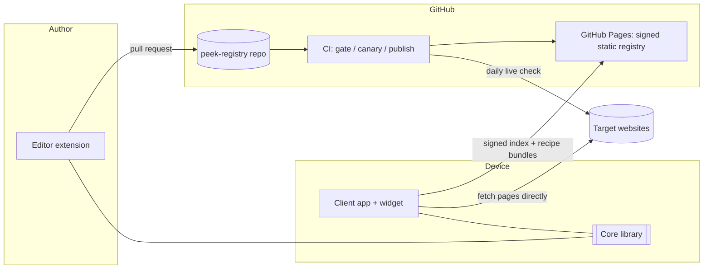
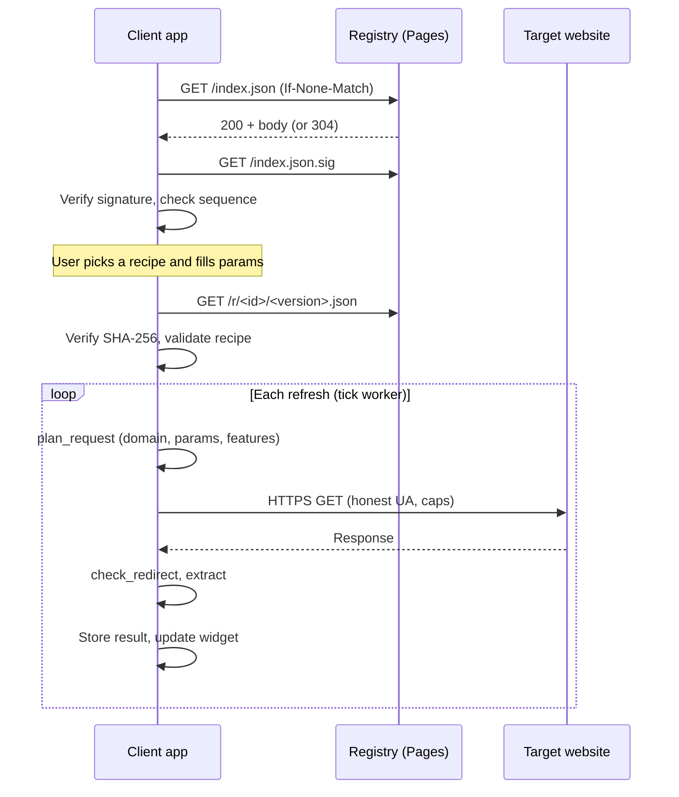
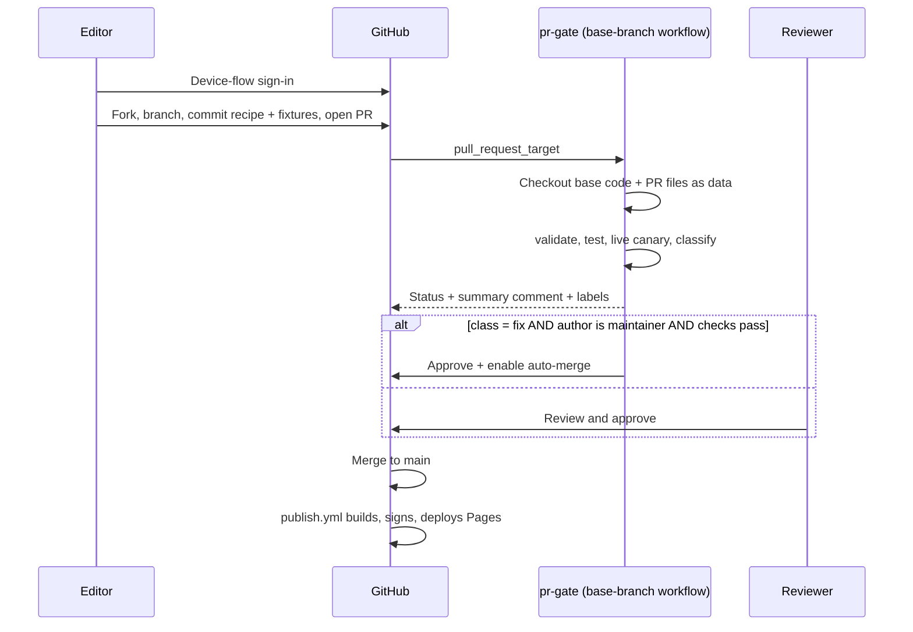
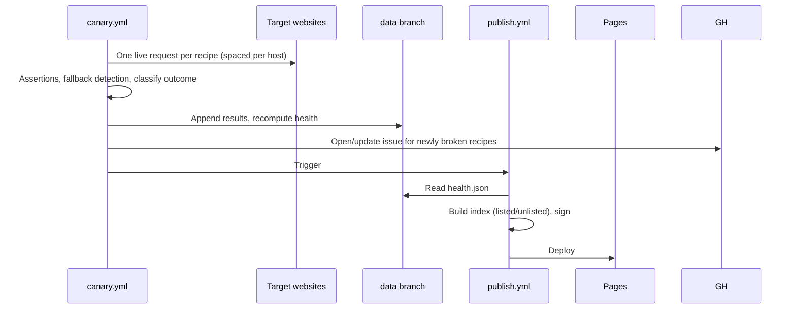

# Peek — System Specification (draft v0.1)

> "Peek" is a **placeholder name** for the project. Rename freely.

## 0. How to use this document

- Written to be handed to AI coding tools. Each component section (4–9) is meant to be implementable when given **§1 (overview), §2 (Recipe Spec), §3 (Result document)** plus that component's own section.
- Keywords **MUST**, **SHOULD**, **MAY** are used in the RFC 2119 sense.
- Build order and acceptance criteria are in §12. Start with the conformance cases (§5), then the core, then everything else.
- This supersedes the rough recipe sketch from earlier discussion (field names differ).

---

## 1. System overview

### 1.1 Goals and non-goals

**Goals**
- Let a user put chosen pieces of data from any website on a home-screen widget (e.g. train times), defined by a declarative *recipe* (CSS selectors, JSON paths, transforms).
- Recipes are community maintained in **one shared registry** with quality control and freshness tracking.
- The recipe format, registry format and client behaviour are an **open protocol**, so anyone can build clients (iOS, Linux, desktop) or editors.
- Everything runs on **free infrastructure** (GitHub only). There is no backend server to operate.

**Non-goals for v1**
- Sites that need a login.
- Any central server that scrapes on users' behalf.
- Telemetry or analytics.
- Running arbitrary page JavaScript outside the sandboxed renderer (§8.3), which exists only to build the DOM so it can be scraped. Recipes themselves still never contain code.
- Scripting inside recipes. Recipes are data, never code.
- Push notifications.

### 1.2 Components

| Component | Repo | Language | Runs on | Responsibility |
|---|---|---|---|---|
| Spec + conformance | `peek-spec` | Markdown, JSON Schema, test data | n/a | Normative docs, schemas, conformance cases |
| Core library | `peek-core` | Rust | Inside every client/editor/CLI | Parse, validate, plan requests, extract, render view model. **No I/O.** |
| CLI | `peek-core` (bin) | Rust | Dev machines, CI | Wraps core with HTTP; validate, test, canary, build/sign index |
| Registry | `peek-registry` | YAML + GitHub Actions | GitHub (repo + Pages) | Hosts recipes, quality gates, health checks, signed static index |
| Android client | `peek-android` | Kotlin | User's phone | Browse/install recipes, schedule refresh, render widgets |
| Editor | `peek-editor` | TypeScript (WebExtension) + core via WASM | Desktop browser | Build recipes by clicking elements, preview, submit PR |
| Other clients | third parties | any | any | Must pass conformance suite (§5) and client rules (§8.1) |

### 1.3 Architecture



### 1.4 Design principles

1. **Recipes are data.** Fixed vocabulary of locators and transforms. No scripting.
2. **Core is pure.** It never touches network, disk or clock. Clients supply HTTP responses and the current time. This makes it deterministic and conformance-testable.
3. **The device fetches.** No central scraping. Private, scalable, never IP-blocked as a group.
4. **Registry is static and signed.** Clients trust a signature, not the hosting.
5. **Fail visibly, keep last good data.** Show stale data with its age; never show a blank widget silently.
6. **Be polite.** Honest User-Agent, minimum refresh intervals, per-host rate limits, response size caps.

### 1.5 Trust model

| Artefact | Produced by | Verified by | How |
|---|---|---|---|
| `index.json` | Registry `publish` workflow | Clients | Detached Ed25519 signature; public key embedded in client (§6.5) |
| Recipe bundle | Registry `publish` workflow | Clients | SHA-256 listed in the signed index |
| Recipe source (PR) | Contributors | Registry gate + human reviewers | CI + review policy (§6.6, §6.8) |
| Local recipe | User | Nobody | Marked "unverified"; extra restrictions apply (§8.1) |

---

## 2. Recipe specification (the protocol)

### 2.1 File format

- A recipe is one document, authored as **YAML 1.2 (core schema)** or JSON. The registry stores `recipe.yaml`.
- YAML restrictions: UTF-8; no anchors, aliases, merge keys or custom tags; single document; duplicate keys are an error; all keys are strings; max nesting depth 12.
- The **canonical form** is JSON per RFC 8785 (JCS). Bundles, hashes and conformance comparisons use the canonical form.
- Unknown keys MUST be rejected (strict). New keys are introduced only via spec versions or declared features (§2.13).
- Size limits: recipe ≤ 64 KB; ≤ 10 params; ≤ 5 lists; ≤ 40 top-level fields; ≤ 30 fields per list; ≤ 5 locators per field; ≤ 10 transforms per field.

### 2.2 Top-level fields

| Field | Required | Type | Notes |
|---|---|---|---|
| `spec` | yes | integer | Major spec version. This document: `1`. |
| `id` | yes | string | `^[a-z0-9]+(\.[a-z0-9-]+)+$`, ≤ 100 chars. Reverse-domain of the site plus a slug, e.g. `uk.co.example-rail.departures`. **Immutable.** Must equal the folder name in the registry. `local.*` is reserved for local recipes. |
| `version` | yes | integer ≥ 1 | Increases by exactly 1 per published change. |
| `name` | yes | string ≤ 60 | Human name. |
| `description` | yes | string ≤ 280 | |
| `params` | no | array | §2.3 |
| `fetch` | yes | object | §2.5 |
| `extract` | yes | object | §2.6 |
| `display` | yes | object | §2.9 |
| `tests` | registry: yes | object | §2.10 |

### 2.3 Params

User-supplied inputs (e.g. station codes).

```yaml
params:
  - key: from                 # ^[a-z][a-z0-9_]*$, unique
    label: From station code  # ≤ 60
    type: string              # string | integer | boolean | enum
    required: true            # default true
    default: null
    placeholder: "EUS"
    help: "Three-letter code"
    pattern: "^[A-Z]{3}$"     # string only; RE2 subset (§2.8)
    min: 0                    # integer only
    max: 100
    options:                  # enum only
      - { value: "dep", label: "Departures" }
      - { value: "arr", label: "Arrivals" }
```

Params are validated by `plan_request` before use. Failure → `PARAM_INVALID`.

### 2.4 Template syntax

Used in `fetch.url`, `fetch.body`, and all `display` strings.

- `{params.key}` — a param value. `{name}` — an extracted field (display only). `{{` and `}}` are literal braces.
- Filters: `{params.from|upper}`, `|lower`, `|trim`. Chainable: `{x|trim|upper}`.
- **Encoding is automatic by context:** URL path/query → percent-encoded; form body → `application/x-www-form-urlencoded`; JSON body → JSON-string-escaped; display → no encoding.
- **Fetch templates may only reference `params.*`.** Display templates may reference `params.*`, top-level fields, and (inside a list `row`) the row's fields. Resolution order for bare names: row fields, then top-level fields.
- **Null rule (display only):** if a template references a null or missing value, the whole template renders as `null` (omitted by clients). Example: `"Platform {platform}"` is omitted when `platform` is null.
- Value rendering in display templates: string as-is; number/integer canonical decimal; `time` as `HH:MM`; `datetime` as `YYYY-MM-DD HH:MM` in the recipe timezone; boolean `true`/`false`; severity/url as-is.
- The scheme and host portion of `fetch.url` MUST be literal (no placeholders). Placeholders are permitted only from the first `/` after the host onward.

### 2.5 `fetch`

```yaml
fetch:
  method: GET                  # GET | POST, default GET
  url: "https://www.example-rail.co.uk/live/{params.from}/{params.to}"
  headers:                     # optional; allowlist below
    Accept-Language: "en-GB"
  body:                        # POST only
    type: form                 # form | json | text
    content: { station: "{params.from}" }   # map for form/json, string for text
  format: html                 # REQUIRED: html | json | xml | text
  allowed_domains: ["www.example-rail.co.uk"]   # exact hostnames, ≥ 1
  timeout_s: 15                # 1–30, default 15
  min_interval_s: 900          # ≥ 300, default 900. Clients MUST NOT refresh more often.
  render: static               # static (default) | js  (js needs feature render.js, see §2.5.1)
  # --- render: js only ---
  wait_for: "table.departures" # CSS selector that must exist before the DOM is captured
  wait_timeout_s: 20           # 1–30, default 20
  resource_domains: ["images.example-rail.co.uk"]   # extra hosts the page may load subresources from
  block_resources: [image, media, font]             # default shown; may also include stylesheet
  capture:                     # supplemental data: network responses to keep as extra documents
    - { name: board, url_pattern: "https://www.example-rail.co.uk/api/*/departures*", format: json }
```

Rules:
- URL scheme MUST be `https`. The URL host MUST be in `allowed_domains`. Every redirect target MUST also be https and in `allowed_domains`, else `REDIRECT_NOT_ALLOWED`. Max 5 redirects.
- Allowed request headers: `Accept`, `Accept-Language`, `Content-Type`, `X-Requested-With`, `Referer` (only if its host is allowed). Everything else (notably `Cookie`, `Authorization`, `Host`, `User-Agent`, `Sec-*`, `Proxy-*`) is forbidden. Clients send an honest `User-Agent: Peek/<version> (+<project url>)`. Recipes cannot override it. For `render: js` the renderer keeps the browser engine's default User-Agent and appends ` Peek/<version>`.
- No cookies are persisted between runs in v1.
- Response body cap: 2 MB after decompression (`RESPONSE_TOO_LARGE`).
- `format: html` is parsed with the HTML5 parsing algorithm. Encoding: BOM, then `Content-Type` charset, then `<meta charset>`, then UTF-8. `format: xml` requires feature `xpath`.

### 2.5.1 Rendered fetch (`render: js`)

For pages whose content is built by JavaScript after load. The **client** (not the core) loads the page in a sandboxed browser engine, then hands the core a snapshot, so the core stays pure and everything downstream (locators, transforms, display) is unchanged. Full renderer rules are in §8.3.

- **Page document.** After the ready condition (below), the renderer serialises the DOM (`document.documentElement.outerHTML`) and supplies it as the response body, with `fetch.format` normally `html`. `<script>` contents are preserved, so embedded-JSON locators still work. Shadow DOM and `<iframe>` contents are **not** included in v1.
- **Ready condition.** The `load` event has fired **and** `wait_for` matches. If `wait_for` is omitted, wait for network idle (no in-flight requests for 500 ms). If not satisfied within `wait_timeout_s` → `RENDER_TIMEOUT`. Prefer `wait_for`: it is faster and more deterministic.
- **Network policy.** Top-level navigation and redirects MUST stay within `allowed_domains`. Subresource requests (scripts, XHR/fetch, frames) are permitted only to `allowed_domains` ∪ `resource_domains` (≤ 10 hosts, https only); everything else is blocked, which also removes ads and analytics. Resource types in `block_resources` (default `image`, `media`, `font`) are blocked to save time, data and battery.
- **Captured documents ("supplemental data").** Each `capture` rule (≤ 3) keeps the **first** network response whose full URL matches `url_pattern` (glob; `*` matches any run of characters), up to 1 MB, as a named extra document in the declared `format` (`json`, `html`, `xml`, `text`). If no response matches, the document is absent and locators reading it yield nothing (so fallbacks apply). Captured documents let a recipe read the page's own data feed even when that feed only works inside a live page session.
- **Isolation.** Fresh, cookie-less, storage-less browser context per run; all permissions denied; popups, downloads and dialogs suppressed. Recipes supply no script; the renderer may inject only a fixed, spec-published recorder (§8.3).
- **Limits.** Hard cap 30 s total; snapshot ≤ 2 MB (else `RESPONSE_TOO_LARGE`); `min_interval_s` ≥ 900 for `render: js` recipes.

### 2.6 `extract`

```yaml
extract:
  fields:                      # top-level scalar values (optional)
    updated: { from: [ { css: "p.last-updated" } ], type: string, optional: true }
  lists:                       # named lists of items (optional)
    departures:
      items: [ { css: "table.departures tbody tr" } ]   # locators, fallback order
      min_items: 1             # default 1. 0 = may legitimately be empty
      limit: 50                # default 50, max 100
      fields:
        time: { from: [ { css: "td.time" }, { css: "[data-col=time]" } ], type: time }
```

Names (fields and lists) match `^[a-z][a-z0-9_]*$` and are unique across top-level fields and lists.

#### Locators

A locator is an object with **exactly one** primary key:

| Primary key | Applies to format | Meaning |
|---|---|---|
| `css` | html | CSS selector (see below) |
| `xpath` | html, xml | XPath 1.0 (feature `xpath`) |
| `json_path` | json | JSONPath (RFC 9535) |
| `const` | any | Literal string |

Optional modifiers (for `css`/`xpath`): `attr` (read an attribute instead of text), `text: all | own` (default `all` = whitespace-normalised textContent; `own` = only direct text nodes), `nth` (0-based, default 0, scalar fields only), `join` (string; if present, all matches are concatenated with it instead of taking `nth`).

`css` may also take `json_path` to parse the selected element's text as JSON (for `<script type="application/json">` or JSON-LD) and then apply the path.

**Sources.** Any locator may add `source: <name>` to read from a captured document (§2.5.1) instead of the page. Default is `page`. The locator kind must suit that document's format (`json_path` for a JSON capture).

**Items from JSON.** A list's `items` locator that uses `json_path` (either on a JSON document, on a JSON capture, or combined with `css` for embedded JSON) yields **one JSON value per match**, in order. Within such a list, every field locator MUST be `json_path` (relative to the item, `$` = item) or `const`. Example (embedded JSON in an HTML page):

```yaml
lists:
  departures:
    items: [ { css: "script#__NEXT_DATA__", json_path: "$.props.pageProps.board.services[*]" } ]
    fields:
      time: { from: [ { json_path: "$.scheduled" } ], type: time }
```

**Scope.** In a list, `items` locators run against the document root; each field's locators run **relative to the item** (`:scope` is the item; for JSON, `$` is the item). Top-level fields run against the document root.

**CSS support (required):** Selectors Level 3 plus `:is()`, `:where()`, `:not()` with complex selectors, `:scope`, attribute operators `= ~= |= ^= $= *=` with `i` flag. **Not supported:** pseudo-elements, user-action/state pseudo-classes. `:has()` requires feature `css.has`.

#### Evaluation of a field

1. Try each locator in `from` in order. A locator yields a string, or nothing. JSON scalars are converted to strings (numbers canonical, booleans `true`/`false`); JSON `null`/objects/arrays count as nothing.
2. An empty string after trimming counts as nothing.
3. Apply `transforms` in order. Any transform failure, an empty result, or a type-conversion failure (§2.7) makes **that locator candidate fail**, and the next locator is tried.
4. First candidate that survives wins. If it was not the first locator, record a diagnostic `fallbacks_used` (this signals recipe decay).
5. If all fail: use `default` if set; else if `optional: true` the value is `null`; else the field is **missing**.

A **missing** top-level field → error `FIELD_MISSING`. A missing required field in a list item → that **item is skipped** (recorded in `skipped_items`). After processing, fewer than `min_items` valid items → error `TOO_FEW_ITEMS`. `min_items` is the main breakage detector, so avoid setting it to 0 unless an empty list is genuinely normal.

Field attributes: `from` (required), `type` (default `string`), `optional` (default false), `default` (literal), `transforms`.

### 2.7 Types

All extracted values are strings until converted. Conversion happens after transforms. Strict; use transforms to normalise first.

| Type | Accepts (after transforms) | Stored as |
|---|---|---|
| `string` | any non-empty string | string |
| `number` | `^-?\d+(\.\d+)?$` | JSON number |
| `integer` | `^-?\d+$` | JSON number |
| `boolean` | exactly `true` or `false` | JSON boolean |
| `time` | `^([01]?\d\|2[0-3]):[0-5]\d$` (normalised to zero-padded `HH:MM`) | string |
| `datetime` | ISO 8601, with offset or local (local assumed in recipe `timezone`, output always with offset) | string |
| `severity` | exactly one of `ok`, `warn`, `bad`, `info`, `neutral` | string |
| `url` | absolute `http(s)` URL, or relative (resolved against the final response URL) | string |

### 2.8 Transforms

Each transform is `{ op: <name>, ...args }`. Fixed library — no others exist in v1.

| op | Args | Behaviour |
|---|---|---|
| `trim` | – | Strip Unicode whitespace both ends |
| `collapse_ws` | – | Replace runs of whitespace with one space; trim |
| `lower` / `upper` | – | Unicode simple case mapping, locale-independent |
| `replace` | `find`, `with` | Literal replace all |
| `regex_replace` | `pattern`, `with` | Replace all; `$1`..`$9` group refs |
| `regex_extract` | `pattern`, `group` (default 1) | First match's group; no match → fail |
| `split` | `sep`, `index` | Literal separator; negative index counts from end; out of range → fail |
| `strip_prefix` / `strip_suffix` | `value` | Remove if present; otherwise unchanged |
| `prepend` / `append` | `value` | Add text |
| `truncate` | `max` | Cut to `max` Unicode scalar values |
| `parse_number` | `decimal` (default `.`), `thousands` (default `,`) | Removes everything except digits, sign and the decimal mark; outputs canonical decimal |
| `parse_time` | `format` | strftime subset `%H %M %I %p %S`; outputs `HH:MM` |
| `parse_datetime` | `format`, `tz` (default recipe timezone) | strftime subset `%Y %m %d %b %B %H %M %S %I %p %z`; English month names; if no year in format, use the year of the supplied `now`; outputs ISO 8601 with offset |
| `map` | `table` (string→string), `else`, `ignore_case` (default false) | Exact match after trim; no match and no `else` → fail |

**Regex dialect:** RE2-compatible subset — no backreferences, no lookaround. Implementations MUST use a linear-time engine. Pattern length ≤ 200 characters.

### 2.9 `display`

Describes the view model the core produces. Clients render it natively.

```yaml
display:
  title: "{params.from} → {params.to}"      # optional template
  layout: list                               # list | kv
  # layout: list
  source: departures                         # name of an extract list
  limit: 5                                   # 1–50, default 5 (clients may show fewer on small widgets)
  row:
    primary: "{time}  {dest}"                # required
    secondary: "Platform {platform}"         # optional
    trailing: null                           # optional
    badge: { text: "{status_text}", severity: "{status}" }   # optional; severity must resolve to a severity value
  # layout: kv
  # items:
  #   - { label: "Temperature", value: "{temp}°C" }
  empty_text: "No departures"                # shown when list is empty (only possible when min_items: 0)
  footer: "Updated {updated}"                # optional template
  link: "https://www.example-rail.co.uk/live/{params.from}/{params.to}"   # optional; host must be in allowed_domains
```

Client priority when space is tight: `primary` > `badge` > `trailing` > `secondary` > `footer`.

### 2.10 `tests`

Required in the registry. Fixtures make reviews reproducible; live assertions power the canary.

```yaml
tests:
  fixtures:                        # ≥ 1
    - name: normal
      file: fixtures/normal.html
      response: { status: 200, final_url: "https://www.example-rail.co.uk/live/EUS/MAN" }   # optional, these are the defaults
      params: { from: EUS, to: MAN }
      now: "2026-09-30T08:00:00+01:00"
      expected: fixtures/normal.expected.json    # golden Result (data + view), canonical JSON
    - name: layout-changed
      file: fixtures/changed.html
      params: { from: EUS, to: MAN }
      now: "2026-09-30T08:00:00+01:00"
      expect_error: TOO_FEW_ITEMS                # negative test
  live:
    params: { from: EUS, to: MAN }
    assert:
      - { path: "lists.departures", op: count_gte, value: 1 }
      - { path: "lists.departures[0].time", op: type, value: time }
```

- Fixture file limits: ≤ 512 KB each, ≤ 3 per recipe, text only.
- For `render: js` recipes, `file` is the serialised DOM snapshot and an optional `captured: { <name>: <file> }` map supplies captured documents (same limits per file).
- Assertion `path` addresses the Result `data` object: `fields.x`, `lists.x[0].y`.
- Assertion ops: `exists`, `not_null`, `count_gte`, `count_lte`, `eq`, `matches` (RE2), `type` (one of §2.7).
- `live.params` MUST be values that work at any time of day (e.g. a major station pair).

### 2.11 Complete example

```yaml
spec: 1
id: uk.co.example-rail.departures
version: 3
name: Station departures
description: Next departures between two stations.
params:
  - { key: from, label: From station code, type: string, pattern: "^[A-Z]{3}$", placeholder: EUS }
  - { key: to,   label: To station code,   type: string, pattern: "^[A-Z]{3}$", placeholder: MAN }
fetch:
  url: "https://www.example-rail.co.uk/live/{params.from}/{params.to}"
  format: html
  allowed_domains: ["www.example-rail.co.uk"]
  min_interval_s: 300
extract:
  fields:
    updated:
      from: [ { css: "p.last-updated" } ]
      transforms: [ { op: regex_extract, pattern: "(\\d{2}:\\d{2})" } ]
      type: time
      optional: true
  lists:
    departures:
      items: [ { css: "table.departures tbody tr" } ]
      min_items: 1
      limit: 10
      fields:
        time:
          from: [ { css: "td.time" }, { css: "[data-col=time]" } ]
          type: time
        dest:
          from: [ { css: "td.dest" } ]
        platform:
          from: [ { css: "td.platform" } ]
          optional: true
        status_text:
          from: [ { css: "td.status" } ]
          transforms: [ { op: collapse_ws } ]
        status:
          from: [ { css: "td.status" } ]
          type: severity
          transforms:
            - { op: map, table: { "On time": ok, "Delayed": warn, "Cancelled": bad }, else: neutral }
display:
  title: "{params.from} → {params.to}"
  layout: list
  source: departures
  limit: 5
  row:
    primary: "{time}  {dest}"
    secondary: "Platform {platform}"
    badge: { text: "{status_text}", severity: "{status}" }
  footer: "Updated {updated}"
  link: "https://www.example-rail.co.uk/live/{params.from}/{params.to}"
tests:
  fixtures:
    - name: normal
      file: fixtures/normal.html
      params: { from: EUS, to: MAN }
      now: "2026-09-30T08:00:00+01:00"
      expected: fixtures/normal.expected.json
  live:
    params: { from: EUS, to: MAN }
    assert:
      - { path: "lists.departures", op: count_gte, value: 1 }
```

### 2.12 Semantic validation rules (beyond the JSON Schema)

`validate_recipe` MUST also check:
1. `requires.features` equals exactly the set of optional features used.
2. Every `display.source` names an existing list; every template reference resolves to a param, field, or row field; `badge.severity` resolves to a `severity`-typed field or a literal severity value.
3. Locator kind is compatible with the document it reads: `css` ↔ html page/capture; `json_path` ↔ json document or capture; `xpath` ↔ html/xml; `css` + `json_path` (embedded JSON) is allowed on an html page. Fields inside a JSON-valued list use only `json_path` or `const` (§2.6).
4. Selectors, JSONPaths, XPaths and regexes all compile within the supported dialects and limits.
5. `fetch.url` host is literal, https, and in `allowed_domains`; `display.link` host is in `allowed_domains`.
6. Header allowlist is respected; `wait_for` only with `render: js`; `body` only with `POST`.
7. `min_interval_s` ≥ 300 (≥ 900 with `render: js`); all numeric limits within range.
8. Every param referenced in templates is declared; every declared param is used somewhere.
9. In a list `row`, every referenced field exists in that list.
10. Render-only keys (`wait_for`, `wait_timeout_s`, `resource_domains`, `block_resources`, `capture`) appear only with `render: js`; `capture` names are unique and not `page`; every `source:` names a declared capture; `render: js` implies `min_interval_s` ≥ 900 and feature `render.js`.
11. Registry-only: `license` is `CC0-1.0`; `maintainers` present; `tests` present; no `allowed_domains` entry appears in the registry's `blocked_domains`.

### 2.13 Versioning and optional features

- `spec` is the **major** version. Breaking changes bump it; a client MUST refuse recipes with a `spec` it does not support.
- **Additive** capabilities are shipped as named **features** in `requires.features`. v1 features: `render.js`, `xpath`, `css.has`. A client lacking a required feature marks the recipe **unsupported** (never fails silently).
- New optional keys MAY only be added together with a new feature name. This keeps old clients strict and safe.

---

## 3. Result document and error model

The core's `extract` returns a **Result**. It is deterministic: it contains no timestamps, durations or other environment-dependent values. Clients wrap it in their own envelope (`fetched_at`, `duration_ms`, etc.).

```json
{
  "result_format": 1,
  "recipe": { "id": "uk.co.example-rail.departures", "version": 3 },
  "status": "ok",
  "data": {
    "fields": { "updated": "08:01" },
    "lists": {
      "departures": [
        { "time": "08:15", "dest": "Manchester Piccadilly", "platform": "5", "status_text": "On time", "status": "ok" }
      ]
    }
  },
  "view": {
    "title": "EUS → MAN",
    "layout": "list",
    "rows": [
      { "primary": "08:15  Manchester Piccadilly", "secondary": "Platform 5",
        "trailing": null, "badge": { "text": "On time", "severity": "ok" } }
    ],
    "items": null,
    "empty_text": null,
    "footer": "Updated 08:01",
    "link": "https://www.example-rail.co.uk/live/EUS/MAN"
  },
  "diagnostics": {
    "fallbacks_used": [ { "path": "lists.departures[2].time", "locator_index": 1 } ],
    "skipped_items": [ { "list": "departures", "index": 3, "reason": "FIELD_MISSING:time" } ],
    "warnings": []
  },
  "error": null
}
```

- `status`: `ok` (clean), `degraded` (fallbacks used or items skipped, but valid), `error` (see `error`; `data` and `view` are `null`).
- `error`: `{ "code": "...", "message": "...", "path": "..."|null, "http_status": 503|null }`.
- Key order in the canonical JSON is by JCS rules; arrays preserve document order.

**Error codes**

| Code | Raised by | Meaning |
|---|---|---|
| `UNSUPPORTED_SPEC` | core | `spec` major not supported |
| `UNSUPPORTED_FEATURE` | core | recipe needs a feature the platform lacks |
| `PARAM_INVALID` | core | missing/invalid param |
| `DOMAIN_NOT_ALLOWED` | core | URL host not in `allowed_domains` |
| `REDIRECT_NOT_ALLOWED` | core | final URL not https/allowed |
| `HTTP_STATUS` | core | non-2xx response (`http_status` set) |
| `RESPONSE_TOO_LARGE` | core | body over cap |
| `PARSE_ERROR` | core | body not parseable as declared `format` |
| `FIELD_MISSING` | core | required top-level field absent (`path` set) |
| `TOO_FEW_ITEMS` | core | fewer than `min_items` valid items (`path` set) |
| `NETWORK_ERROR`, `TIMEOUT` | client | transport failures; never produced by core |
| `RENDER_TIMEOUT` | client | `wait_for`/network-idle not reached in `wait_timeout_s` |
| `RENDER_UNAVAILABLE` | client | platform cannot render (e.g. no WebView) |

---

## 4. Core library and CLI specification (`peek-core`)

### 4.1 Requirements

- Implemented in Rust. Pure: **no network, filesystem, clock or randomness.** All inputs are arguments.
- Deterministic and panic-free on any input. All parsers MUST be fuzz-tested (recipe parser, HTML/JSON handling, selector/regex compilers).
- Linear-time regex engine only. Hard limits per §2.1, §2.5, §2.8.
- Target outputs: Rust crate; UniFFI bindings (Kotlin, Swift); WASM (`wasm-bindgen`) for the editor; static C ABI optional.
- HTML parsing: html5ever (or equivalent HTML5-conformant parser). CSS matching: `selectors` crate or equivalent that passes the conformance cases.

### 4.2 Public API (language-neutral)

```
parse_recipe(source: bytes, format: "yaml"|"json") -> Recipe | [ValidationIssue]
validate_recipe(recipe, mode: "registry"|"local", registry_cfg?) -> [ValidationIssue]
canonicalize(recipe) -> bytes                              // RFC 8785 JSON
plan_request(recipe, params: map, platform_features: [string], mode) -> RequestPlan | Error
check_redirect(recipe, final_url: string, mode) -> ok | Error
extract(recipe, params: map, response: Response, now: string /*ISO 8601 with offset*/) -> Result
run_fixture_tests(recipe, files: map<path, bytes>) -> TestReport
evaluate_assertions(result, assertions) -> [AssertionResult]
classify_change(old: Recipe?, new: Recipe) -> "new"|"fix"|"change"|"breaking"
selector_candidates(html: string, target_node_path) -> [RankedSelector]   // used by editor only (§9.3)

RequestPlan  = { method, url, headers, body?, format, render, timeout_s,
                 min_interval_s, allowed_domains, max_response_bytes,
                 render_options?: { wait_for?, wait_timeout_s, resource_domains,
                                    block_resources, capture: [{name, url_pattern, format}] } }
Response     = { status: int, final_url: string, headers: map, body: bytes,
                 captured?: map<name, { url: string, status: int, body: bytes }> }
// For render: js, `body` is the serialised DOM snapshot and `status` is the main document's HTTP status.
ValidationIssue = { severity: "error"|"warning", code, path, message }
```

Notes:
- `plan_request` MUST substitute and encode params exactly per §2.4, and reject non-literal hosts.
- In `mode: "local"`, validation relaxes: no `maintainers`/`tests`/license rules; private-host targets MAY be allowed (see §8.1 rule C9). In `mode: "registry"` private, loopback and link-local targets are always rejected.
- `classify_change`: `new` if no old; `fix` if the only differences are inside `extract.**.from`, `extract.**.items`, or `transforms`, **and** params/fetch/display/requires are unchanged; `breaking` if param keys/types changed or `id` differs; otherwise `change`. `version` and `tests` differences are ignored for classification.

### 4.3 CLI (`peek`)

| Command | Purpose | Exit codes |
|---|---|---|
| `peek validate <path>…` | Parse + validate recipes (`--mode registry\|local`) | 0 ok, 1 issues |
| `peek test <recipe-dir>` | Run fixture tests (golden + `expect_error`) | 0 pass, 1 fail |
| `peek run <recipe> --param k=v [--fixture file] [--json]` | Run once (live fetch with static HTTP, or from fixture) and print Result | 0 ok/degraded, 1 error |
| `peek canary <recipe-dir> --json` | Live run + assertions; prints classified outcome (§6.7) | 0 pass, 1 fail, 2 blocked/unknown |
| `peek classify <base-recipe> <new-recipe>` | Print change class | 0 |
| `peek bundle <recipe-dir> -o <out>` | Canonical bundle + SHA-256 | 0 |
| `peek index build --recipes <dir> --health <file> --config registry.json -o <outdir>` | Produce `index.json`, bundles, `registry.json` | 0 |
| `peek sign <file> --key <keyfile>` / `peek verify <file> --sig <sig> --pubkey <key>` | Ed25519 detached signature | 0 ok |
| `peek conformance --impl <cmd> [--cases <dir>]` | Run conformance suite against an implementation | 0 pass |

The CLI is the only component that performs HTTP for CI. It MUST: send the honest User-Agent, enforce domains/redirects/size/timeouts, **refuse to connect to private, loopback or link-local IP addresses (check the resolved IP, to defeat DNS rebinding)** in registry mode, and serialise requests per host with ≥ 5 s spacing. For `render: js` recipes the CLI drives headless Chromium (Playwright) following the renderer contract in §8.3.

---

## 5. Conformance suite (`peek-spec/conformance`)

Purpose: make independent implementations (new languages, new platforms) behave identically.

**Layout**
```
conformance/
  cases/<NNN-short-name>/
    recipe.yaml
    params.json             # {}
    response.body           # raw bytes
    response.meta.json      # { "status": 200, "final_url": "...", "headers": {} }
    now.txt                 # ISO 8601 with offset
    expected.json           # canonical Result (§3)
  cases-optional/<feature>/…   # same layout; for xpath, css.has, render.js
  README.md                  # runner protocol
```

**Coverage (minimum)**
- Every CSS selector feature in §2.6 including `:scope`, `:is`, `:not`, attribute operators, scoping inside list items.
- Locators: `attr`, `text: own`, `nth`, `join`, `const`, embedded JSON via `css`+`json_path`, JSONPath on JSON responses.
- Fallback order and `fallbacks_used` diagnostics; skipped items; `min_items`; `optional`; `default`.
- Each transform with normal and edge cases (empty, no match, negative split index, unicode, regex limits).
- Each type conversion, success and failure.
- Templates: escaping, filters, null rule, encoding per context.
- Display: list and kv, badge severity.
- Security: domain mismatch, redirect to disallowed host, non-https, oversized body, forbidden headers.
- Every error code in §3.
- `cases-optional/render.js`: DOM snapshots with embedded JSON, captured JSON documents (`response.captured/<name>.json` plus metadata), absent capture falling back to the next locator, JSON-valued lists.

**Runner protocol:** an implementation exposes an executable that reads a case directory and prints the Result as canonical JSON on stdout. The runner compares bytes. Implementations MAY alternatively provide a native harness that loads the same files. An implementation may claim "Peek spec 1.x conformant" only if it passes **all** `cases/` and declares which `cases-optional/` features it supports.

---

## 6. Registry specification (`peek-registry`)

One canonical repository on GitHub, published as a **static, signed site on GitHub Pages**. No server code.

### 6.1 Repository layout

```
peek-registry/
  registry.json                  # registry config + policy (also published)
  recipes/<id>/recipe.yaml       # folder name == recipe id
  recipes/<id>/fixtures/…        # fixtures + expected goldens
  archive/<id>/…                 # retired recipes (reviewers/bot only)
  .github/CODEOWNERS
  .github/ISSUE_TEMPLATE/submit-recipe.yml
  .github/ISSUE_TEMPLATE/report-broken.yml
  .github/workflows/pr-gate.yml  submit-to-pr.yml  canary.yml  publish.yml
  docs/CONTRIBUTING.md  docs/POLICY.md
branch `data` (orphan)           # canary output, written only by canary.yml
  health.json                    # current state + last 30 results per recipe
```

### 6.2 Recipe lifecycle

| Status (in `recipe.yaml`) | Meaning | Set by |
|---|---|---|
| `experimental` | New or unproven; shown with a label | default |
| `verified` | Reviewed by 2 reviewers, healthy ≥ 30 days, ≥ 1 maintainer besides the author | reviewers via PR |
| `deprecated` | Superseded or abandoned; hidden from default browse | reviewers via PR |
| (archived) | Moved to `archive/`; kept only in `revoked` list if unsafe | bot PR after 90 days broken |

Health (`healthy`/`degraded`/`broken`/`blocked`/`unknown`) is **computed**, never stored in `recipe.yaml` (§6.7).

### 6.3 Published protocol (static endpoints)

Base URL is configurable in clients; default is the official registry's Pages URL.

| Path | Content |
|---|---|
| `/registry.json` | Registry metadata, policy, contact, URL templates for reporting (§6.4) |
| `/index.json` | The index (§6.4) |
| `/index.json.sig` | Detached Ed25519 signature over the exact bytes of `index.json` (§6.5) |
| `/r/<id>/<version>.json` | Canonical recipe bundle. Content-addressed by SHA-256 in the index. Immutable; long cache lifetime. Only the **latest** version of each recipe is deployed. |

All files are served with gzip/brotli and ETag (Pages does this). Clients use conditional requests for `index.json`.

### 6.4 File formats

**`registry.json`**
```json
{
  "format": 1,
  "id": "peek-official",
  "name": "Peek Community Registry",
  "base_url": "https://<org>.github.io/peek-registry/",
  "repo": "https://github.com/<org>/peek-registry",
  "submit": { "repo": "<org>/peek-registry", "issue_form_url": "https://github.com/<org>/peek-registry/issues/new?template=submit-recipe.yml" },
  "report_broken_url_template": "https://github.com/<org>/peek-registry/issues/new?template=report-broken.yml&recipe={id}&version={version}&error={error_code}&client={client}",
  "signing_keys": [ { "key_id": "k1", "algorithm": "ed25519", "public_key": "<base64>", "not_after": "2028-01-01" } ],
  "policy": {
    "min_interval_s": 300,
    "health": { "broken_after_consecutive_failures": 2, "unlist_after_days_broken": 14, "archive_after_days_broken": 90 },
    "canary": { "cron": "17 4 * * *", "per_host_spacing_s": 5 }
  },
  "blocked_domains": [ { "domain": "example.org", "reason": "owner request", "date": "2026-09-01" } ],
  "contact": "registry@example.org"
}
```

**`index.json`**
```json
{
  "format": 1,
  "registry_id": "peek-official",
  "generated_at": "2026-10-01T04:30:00Z",
  "sequence": 1790829000,
  "min_client_spec": 1,
  "recipes": [
    {
      "id": "uk.co.example-rail.departures",
      "version": 3,
      "name": "Station departures",
      "description": "Next departures between two stations.",
      "status": "verified",
      "country": "GB",
      "tags": ["rail", "transport"],
      "requires": { "features": [] },
      "params": [ { "key": "from", "label": "From station code", "type": "string", "required": true } ],
      "maintainers": ["alice-gh"],
      "updated_at": "2026-09-28T10:00:00Z",
      "health": { "state": "healthy", "checked_at": "2026-10-01T04:20:00Z", "since": "2026-08-01T04:20:00Z" },
      "listed": true,
      "bundle": { "path": "r/uk.co.example-rail.departures/3.json", "sha256": "<hex>", "size": 4821 }
    }
  ],
  "revoked": [ { "id": "uk.co.bad.recipe", "versions": "*", "severity": "disable", "reason": "Security issue" } ]
}
```

- `sequence` is the Unix time of generation. Clients MUST reject an index whose `sequence` is lower than the last accepted one (anti-rollback).
- Index size grows linearly. If it exceeds ~2 MB, split by `country` into `index/<cc>.json` shards, each signed; the top-level index lists shards. (Not needed for v1.)
- `revoked.severity`: `disable` (clients stop running matching instances) or `warn`.

### 6.5 Signing and keys

- Algorithm: Ed25519, detached signature (minisign-compatible format recommended). The private key is a GitHub **Environment secret** (`release` environment, restricted to `main`, required reviewer for changes). The public key(s) are listed in `registry.json` **and embedded in each client** (a client MUST NOT trust keys only because they appear in a downloaded `registry.json`).
- Rotation: add the new key to client releases while the old key is still valid (overlap ≥ 90 days), start signing with the new key, retire the old. Full TUF-style delegation is a possible future upgrade.
- Verification order in clients: verify signature over `index.json` bytes → check `sequence` → parse → for each bundle, check SHA-256 → parse/validate recipe in local mode rules plus registry checks.

### 6.6 CI workflows

**General security rule:** recipes are untrusted data. CI MUST never execute anything from a PR. Gating logic MUST live in workflows defined on the **base branch** (`pull_request_target` / `workflow_run`), checking out PR files into a separate directory **as data only**, and running a **pinned, checksum-verified `peek` CLI release** (never one built from the PR). A PR that edits `.github/**`, `registry.json` or `schemas/` always requires admin review and cannot use the fast lane.

**`pr-gate.yml`** (required status check; `pull_request_target`)
1. Scope check: PR touches exactly one `recipes/<id>/` folder (or `archive/` for reviewers/bot). Otherwise fail.
2. `peek validate --mode registry` (schema + §2.12 rules + id==folder + size limits + text-only fixtures + blocked-domain check).
3. `peek test` (fixtures, goldens, negative tests).
4. Version rule: for an existing recipe, `version` = base `version` + 1; `id` unchanged.
5. `peek canary` once against the live site. Outcome `fail` → check fails. `blocked` → check passes with a warning label `needs-human-live-check`.
6. `peek classify` → label PR: `new`, `fix`, `change`, `breaking`. Also label `breaking-params` when param keys/types change.
7. Post a summary comment (extracted rows preview, fallbacks used, warnings).

**Fast lane** (same trusted workflow, final step): if class is `fix`, the PR author is in the **base branch's** `maintainers` list for that recipe, all checks passed with a live pass (not `blocked`), and no `fetch` changes → the bot approves and enables auto-merge. Everything else requires human review (§6.8).

**`canary.yml`** (cron + manual)
1. For each recipe not `deprecated`: run `peek canary` (live test, assertions, fallback detection). One request per recipe per run; per-host serialised with spacing. `render: js` recipes run through headless Chromium (Playwright) per §8.3.
2. Update `data/health.json` (append result, recompute state per §6.7), commit to `data` branch.
3. For recipes that **newly** become `broken`: open or update an issue tagging maintainers (`broken` label, link to last error).
4. Trigger `publish.yml`.
5. Known limitations: GitHub-hosted runner IPs are datacenter addresses and some sites block them (→ `blocked`, not counted as failure); scheduled workflows in public repos are auto-disabled after 60 days of repository inactivity — verify whether canary commits count, otherwise add a keepalive step.

**`publish.yml`** (push to `main`, after canary, manual)
1. Checkout `main` + `data` branch.
2. `peek index build` → `registry.json`, `index.json`, `r/<id>/<version>.json`.
3. `peek sign` using the environment secret.
4. Deploy to Pages via the official upload/deploy actions.
5. Smoke test: download `index.json` + `.sig` from the live URL and run `peek verify`.

**`submit-to-pr.yml`** (fallback submission path; §7).

### 6.7 Health model

Canary outcome per run:
| Outcome | Condition |
|---|---|
| `pass` | HTTP OK, all live assertions pass, no `fallbacks_used`, no skipped items |
| `degraded` | assertions pass but fallbacks used or items skipped |
| `fail` | assertion/`FIELD_MISSING`/`TOO_FEW_ITEMS`/`PARSE_ERROR`, or network error twice in a row within a run |
| `blocked` | 401/403/429/503 or bot-challenge markers; **not counted** as a failure |

State machine over the last results:
- `healthy`: last result `pass`.
- `degraded`: last result `degraded`, or one `fail` after healthy.
- `broken`: ≥ `broken_after_consecutive_failures` (default 2) consecutive `fail`s.
- `blocked`/`unknown`: last results `blocked` or none yet; displayed as "unchecked".
- Index `listed = false` when `status == deprecated` or broken for ≥ `unlist_after_days_broken` (14). Unlisted recipes stay installable by direct id; installed users see a warning.
- After `archive_after_days_broken` (90) a bot PR moves the recipe to `archive/`.

### 6.8 Review policy and roles

| Role | Rights |
|---|---|
| Contributor | Anyone with a GitHub account; submits PRs |
| Maintainer (per recipe) | Listed in `recipe.yaml`; may use the fast lane for `fix` PRs on that recipe |
| Reviewer | GitHub team with merge rights; approves new/changed recipes |
| Admin | Owns CI, keys, `registry.json`, takedowns |

- New recipe or `change`/`breaking`: 1 reviewer approval. Setting `status: verified`: 2 approvals. Changing `maintainers`: reviewer approval always.
- **Reviewer checklist:** site terms and `robots.txt` considered; request is polite (interval, single request); fixture contains no personal data; selectors are stable (editor's score ≥ 60 or justified); display makes sense on a small widget; no unnecessary `allowed_domains`.
- Branch protection on `main`: PR required; required check `pr-gate`; linear history; no force pushes; applies to admins; CODEOWNERS covers `.github/**`, `registry.json`, `schemas/`.

### 6.9 Takedown and revocation

- Site owners (or anyone) can request removal via the issue template or `contact`. Admins add the domain to `blocked_domains` (recipes for it are removed; new ones rejected) and, if urgent, add the recipe to `revoked` with `severity: disable` and republish immediately.
- Because clients enforce `revoked`, takedowns reach users on their next index sync.

---

## 7. Submission flow

Goal: contributors never need Git knowledge, and no backend is needed.

**Primary path: editor → GitHub PR directly (client-side)**
1. Editor asks the user to sign in with GitHub using the **OAuth device flow** (needs only a public client ID; no server or secret). Prefer a **GitHub App** with user-to-server tokens over an OAuth app, because OAuth's `public_repo` scope is coarse (write access to all of the user's public repos). Store the token only in extension storage.
2. Editor forks `peek-registry` (if no fork), creates a branch `recipe/<id>-v<version>`, commits `recipes/<id>/recipe.yaml` + fixtures + goldens, and opens a PR with a templated description.
3. `pr-gate` runs (§6.6). The editor shows the PR link and polls check status so the author can see failures.

**Fallback path: issue form → PR (no sign-in inside the editor)**
1. Editor copies the recipe YAML to the clipboard (and the fixture, if small) and opens `submit-recipe.yml` issue form; the user pastes and submits.
2. `submit-to-pr.yml` (trusted, base-branch workflow) parses the issue body as **data**, writes the files, opens a PR as the bot with `Closes #issue` and credits the issue author. If the issue contains no fixture, a job captures one live (static fetch only) and commits it to the PR branch; reviewers MUST inspect it for personal data.
3. Invalid submissions get an automatic comment listing issues; the issue stays open for edits.

**Updating an existing recipe** uses the same paths. The editor loads the current recipe from the registry bundle, bumps `version`, and submits.

**Abuse controls:** GitHub account required; PR scope check; fixture size limits; rate limiting via GitHub's own limits; reviewers can close and block users per standard GitHub moderation.

---

## 8. Client specification

### 8.1 Rules for **any** client (all platforms)

Third-party clients MUST follow these. They are what makes the ecosystem safe.

| # | Rule |
|---|---|
| C1 | Embed the registry's public signing key(s). Verify `index.json.sig` before trusting the index. Enforce anti-rollback via `sequence`. |
| C2 | Verify every bundle's SHA-256 against the signed index before use. |
| C3 | Use the core library, or an implementation that passes the conformance suite, for everything in §4.2. Never re-implement extraction ad hoc. |
| C4 | Call `plan_request` before every fetch and `check_redirect` on the final URL. Never fetch any URL not produced by `plan_request`. |
| C5 | HTTPS only. No cookies persisted. Send the honest User-Agent. Enforce 2 MB body cap and `timeout_s`. |
| C6 | Never refresh a recipe more often than its `min_interval_s`, and never more than one request per host per 5 seconds. Back off exponentially on repeated failure (cap 6 h). |
| C7 | If `requires.features` contains a feature the client lacks, show the recipe as **unsupported** and do not run it. |
| C8 | Obey `revoked` entries: `disable` stops running affected instances and tells the user why. |
| C9 | Local (unsigned) recipes are clearly labelled "unverified". Private/loopback/link-local hosts are allowed **only** for local recipes and only after an explicit per-recipe user confirmation. Registry recipes MUST never reach private addresses. |
| C10 | No telemetry in v1. Any future signals MUST be opt-in, contain no URLs or param values, and be documented in `registry.json`. |
| C11 | Always keep and show the last good result when a refresh fails, clearly marked stale with its age. |
| C12 | "Report broken" opens the registry's `report_broken_url_template` (from `registry.json`) prefilled with recipe id, version, error code and client name. Never include param values. |
| C13 | `render: js` recipes MUST run only in a renderer that satisfies §8.3 (isolation, network policy, caps). A client without such a renderer marks them unsupported (C7). |
| C14 | Rendering is expensive: at most one render at a time, honour `min_interval_s` ≥ 900, and offer a Wi-Fi/unmetered-only option. |

### 8.2 Functional requirements (reference client: Android)

**Tech stack:** Kotlin, Jetpack Compose (UI), Jetpack Glance (app widgets), WorkManager, Room, OkHttp, core via UniFFI. minSdk 26. Material 3 with dynamic colour, dark mode, TalkBack labels, font scaling.

**Concepts**
- **Registry**: a base URL + embedded public key(s). The official registry is built in; additional registries MAY be added in settings (each with a user-supplied key).
- **Recipe bundle**: a verified recipe at a specific version (stored locally).
- **Instance**: a user's configured use of a recipe: recipe id, params, label, refresh interval, optional pinned version. One widget is bound to one instance. Many instances can use the same recipe.

**Screens**
1. **Home**: list of instances with last result preview, age, health badge; add button.
2. **Browse registry**: search (name, tags, country, id), filters (country, status), sort (relevance, recently updated). Default hides `listed: false`. Badges: verified / experimental / degraded / broken / unsupported.
3. **Recipe detail**: description, maintainers, status, health + since, version, required features, link to source in the repo, "Report broken", "Add".
4. **Instance setup**: form generated from `params` (text with pattern validation, integer with range, switch, dropdown), label, refresh interval (≥ max(recipe `min_interval_s`, 15 min on Android)), live "Test" button showing the rendered view.
5. **Instance settings**: edit params/label/interval, pin/unpin version, delete, view last error/diagnostics.
6. **Local recipes**: import from file or URL, edit as text, mark as local. Uses `local.*` ids. Shows validation issues from `validate_recipe(mode=local)`.
7. **Registries & settings**: registries, sync status, last verified `sequence`, default intervals, "Wi-Fi only" option, diagnostics export.

**Data model (Room)**
```
Registry(id, baseUrl, keysJson, lastSequence, lastSyncAt, etag)
IndexEntry(registryId, recipeId, json)               // cache of last verified index
RecipeBundle(recipeId, version, registryId|null, canonicalJson, sha256)
Instance(id, recipeId, pinnedVersion?, paramsJson, label, intervalS, createdAt)
InstanceState(instanceId, lastResultJson?, lastSuccessAt?, lastAttemptAt?, lastErrorCode?, consecutiveFailures, nextDueAt)
```

**Registry sync**
- On app start and daily (periodic work), and on pull-to-refresh: conditional GET `index.json` (ETag) → fetch `.sig` → verify (§6.5) → store. Failure leaves the previous verified index in place and shows a non-blocking notice.
- Update detection: for each installed recipe, if the index lists a higher `version`:
  - If params schema unchanged (same keys and types): **auto-update** by running the new version once for each instance; switch only on non-error result; otherwise keep the old version and surface a notice.
  - If params changed (`breaking-params`): keep the old version and prompt the user to review.

**Refresh engine**
- A single **tick worker** (WorkManager periodic, 15 min, network-connected constraint) selects instances whose `nextDueAt ≤ now`, runs them with concurrency ≤ 2, honouring C6.
- Per instance:
  1. `plan_request(recipe, params, ["…supported features…"])`.
  2. Per-host rate limiter.
  3. HTTP fetch (OkHttp) with cap/timeout; no cookies.
  4. `check_redirect(recipe, finalUrl)`.
  5. `extract(...)` with `now` from the device clock.
  6. On `ok`/`degraded`: persist result, reset failures, `nextDueAt = now + interval`.
  7. On `error`: keep `lastResultJson`, increment failures, `nextDueAt = now + min(interval × 2^failures, 6 h)`.
  8. Update affected widgets.
- Manual refresh (widget tap on refresh icon, pull-to-refresh) is allowed at most once per 60 s per instance and still respects `min_interval_s` unless the user explicitly overrides in settings (override still subject to the per-host 5 s limit).
- `render: js` recipes run through the renderer in §8.3 (offscreen `WebView`).

**Widget states**
| State | Condition | UI |
|---|---|---|
| Loading | no result yet | Skeleton + spinner |
| OK | latest result `ok` | `view` rendered; footer "Updated HH:MM" |
| Degraded | result `degraded` | As OK, small warning dot; detail in instance settings |
| Stale | last refresh failed, previous result exists, or age > 3 × interval | Previous `view` dimmed with age ("12 min ago") |
| Error | failed and no previous result | Message mapped from error code + retry |
| Unsupported | missing feature / spec | Explanation |
| Disabled | revoked `disable` | Explanation + remove action |

Widget layout: `title` header (if room), up to `limit` rows (fewer on small sizes by the §2.9 priority), `badge` coloured by severity (colour + icon/text, never colour alone), `footer`. Tapping the body opens `view.link` in the browser if present, else the instance screen. Provide at least three size classes (small 2×1, medium 4×2, large 4×4).

**Acceptance (Android v1)**
- Install the example recipe from a locally served test registry; widget shows rows and updates on schedule.
- Tamper test: modifying a bundle or the index makes the client reject it and keep the previous data.
- Airplane mode: widget shows stale data with age, no crash.
- A fixture-based instrumented test renders every `view` shape from the conformance cases.

### 8.3 Renderer contract (`render: js`)

A **renderer** turns a `RequestPlan` with `render: js` into a `Response` (§4.2): DOM snapshot as `body`, plus `captured` documents. It is platform code (not part of the core), but its behaviour is specified so every platform produces equivalent snapshots.

**Procedure**
1. Create a fresh, isolated browser context: no cookies, no local/session storage, no IndexedDB, no service workers. Deny all permissions (camera, mic, geolocation, notifications, clipboard). Suppress popups, downloads, dialogs and `window.open`.
2. Set User-Agent to the engine default plus ` Peek/<version>`. Send `Accept-Language` from the recipe if set.
3. Install request interception: allow only https; allow top-level navigation only to `allowed_domains`; allow subresources only to `allowed_domains` ∪ `resource_domains`; block `block_resources` types; refuse private/loopback/link-local addresses (registry recipes). Count every blocked request for diagnostics.
4. Inject the **recorder** (a fixed script published in `peek-spec/renderer/recorder.js`, never recipe-supplied) at document start. It wraps `fetch` and `XMLHttpRequest`, and for each response whose URL matches a `capture` rule, stores a copy of the body (≤ 1 MB). It cannot see requests made from workers or before injection.
5. Navigate to `plan.url`. Wait for the ready condition (§2.5.1) or the timeout.
6. Serialise `document.documentElement.outerHTML` and read the recorder's captured bodies.
7. Destroy the context (clear cookies/storage/cache for it) and return the `Response`. Errors map to `RENDER_TIMEOUT`, `RENDER_UNAVAILABLE`, `DOMAIN_NOT_ALLOWED`/`REDIRECT_NOT_ALLOWED`, `RESPONSE_TOO_LARGE`, `NETWORK_ERROR`.

**Platform notes**

| Platform | Engine | Notes |
|---|---|---|
| Android | Offscreen `WebView` | Must be created and driven on the main thread (use `Dispatchers.Main` from the worker, application context). Use `WebViewClient.shouldInterceptRequest` for blocking; the recorder is injected with `WebViewCompat.addDocumentStartJavaScript` where `DOCUMENT_START_SCRIPT` is supported, otherwise capture is unavailable and recipes needing it are marked unsupported. Response bodies are not visible to `shouldInterceptRequest`, which is why the recorder exists. If the OS kills the process mid-render, treat as failure and retry later. |
| iOS | `WKWebView` | Cannot run inside a WidgetKit extension. The **app** renders (foreground, or `BGAppRefreshTask` which the OS schedules at its discretion) and writes results to a shared container for the widget to display. Expect much lower freshness than Android. Use `WKContentRuleList` for blocking and a `WKUserScript` for the recorder. |
| Linux / desktop | WebKitGTK, system WebView (Tauri), or headless Chromium (CDP) | Interception via the engine's request API or CDP `Fetch` domain. |
| CLI / CI | Headless Chromium via Playwright | Used by `peek canary` and `peek run` for `render: js` recipes. Datacentre IPs may be blocked, so outcomes can be `blocked` (§6.7). |

**Cost controls:** one render at a time per device; `min_interval_s` ≥ 900; blocked images/media/fonts by default; hard 30 s cap; optional "Wi-Fi only"; the tick worker prefers batching due `render: js` instances together.

**Renderer conformance (`peek-spec/renderer-tests`)**: a small local HTTPS test server and expected snapshots covering: DOM built by JS after a delay; data fetched by XHR after load (capture works); a blocked third-party host; a host allowed via `resource_domains`; cookies set by the page are gone on the next run; navigation or redirect to a disallowed host is refused; popup suppression; `wait_for` timeout produces `RENDER_TIMEOUT`. A platform may claim `render.js` support only if it passes these.

---

## 9. Editor specification (`peek-editor`)

A desktop **WebExtension** (Chromium + Firefox, Manifest V3) with a side panel. It uses the core via WASM for all extraction/preview so results match the clients exactly.

### 9.1 Workflow

1. **Start**: on the target page, click "Create recipe" (or "Edit recipe" after picking an existing registry recipe/local file).
2. **Capture snapshot**: serialise the DOM after load. Also record, via `webRequest`/devtools, JSON/XHR responses the page made (URL, content type, body up to 1 MB).
3. **Pick**: choose "single value" or "list". Click an element; the editor highlights it and proposes selectors (§9.3). For lists, click a row; the editor finds the repeating row pattern and shows all matched rows.
4. **Define fields**: name, type, optional, transforms (chosen from the §2.8 library with live preview of each step), and fallbacks (extra locators).
5. **Parameterise**: highlight parts of the URL and mark them as params (`from`, `to`), set labels/patterns, provide sample values.
6. **Display**: choose layout and map fields to `primary/secondary/badge/footer` with a live widget-style preview at small/medium sizes.
7. **Verify**: run `validate_recipe`, run extraction against the snapshot, run a **generalisation test** (§9.4), show warnings.
8. **Fixtures & tests**: auto-generate `fixtures/*.html` (sanitised) + goldens via core; user supplies `live` params; editor proposes assertions.
9. **Save/Submit**: save as local recipe (export file, or import link into the Android app via a `peek://import` handoff) or submit to the registry (§7).

### 9.2 Static vs rendered detection

- Fetch the page with a plain static request (extension host permission) and run the chosen selector against it. If the element is missing in static HTML, warn: "This page builds this content with JavaScript."
- Then search captured XHR/JSON bodies for the selected text. If found, offer **"Use JSON endpoint"**: create a recipe with `format: json` and a suggested `json_path` against that URL. JSON endpoints are preferred (more stable, lighter).
- If neither works, the recipe needs `render: js`. The editor sets `render: js`, proposes a `wait_for` (the selected element's selector), records which hosts the page needed to load its data and proposes them as `resource_domains`, and offers any matched XHR response as a `capture` rule so the recipe can read the feed (`source:`) instead of the fragile DOM. Fixtures are the serialised DOM plus captured documents.

### 9.3 Selector stability ranking

`selector_candidates` (in core, so it is shared and unit-tested) returns up to 5 ranked candidates with a score 0–100 and human-readable reasons.

Generation strategies, in order of preference:
1. Stable attributes: `id` (unless it looks generated), `data-*` attributes, `itemprop`, `aria-label`/`role`, `name`.
2. Semantic structure: tag names with meaningful classes (`table.departures td.time`).
3. Short structural paths anchored on a stable ancestor.
4. Positional (`:nth-child`) only as a last resort.

Scoring (guide; weights tunable, must be deterministic):
- **+** stable attribute (`data-*`, `itemprop`, `aria-*`) +30; semantic, human-readable class +20; short selector (≤ 3 compound steps) +10; anchors to an element with a stable `id` +15; text-independent +5.
- **−** positional `:nth-child`/`:nth-of-type` −20 each; class that looks generated (CSS-modules/hash style such as `[a-z]+_[A-Za-z0-9]{5,}`, `css-[a-z0-9]{5,}`, `sc-[A-Za-z0-9]+`, long hex/base64-like tokens, or Tailwind-like utility chains of ≥ 4) −30; very long descendant chain (> 5 steps) −15; relies on generated `id` −30; depends on visible text content −15.
- Validation: a scalar candidate MUST match exactly the intended element; a list candidate MUST match exactly the visible rows. Candidates failing this are discarded.

The top candidates are automatically placed into `from:` as primary + fallbacks (diverse strategies preferred, so one redesign doesn't break all).

### 9.4 Generalisation test

Optional but encouraged: user supplies a second set of param values. The editor fetches that variant page and runs the recipe. Failing selectors reveal overfitting (e.g. relying on an element that only exists for the sample route).

### 9.5 Fixture capture and sanitisation

- Strip `<script>` (except `type="application/json"` / JSON-LD blocks that selectors use), inline event handlers, `<iframe>`, comments, `<style>` where not needed, and tracking parameters in URLs.
- Warn on strings that look like emails, phone numbers, tokens, or session IDs; require the author to confirm.
- Minify whitespace; enforce ≤ 512 KB; show size.

### 9.6 Non-functional

- Everything runs locally; no recipe data leaves the machine until the user submits.
- Editor core logic (selector ranking, row detection, XHR matching) is a separate module with its own tests; the extension shell is thin.
- Accessibility: keyboard-navigable picker and panels.

**Acceptance (editor v1)**
- Reproduce the example recipe from scratch against a saved copy of a real departure board page in under 10 minutes.
- Selector ranking test set: ≥ 20 saved pages with expected best selectors; top-1 or top-2 matches for ≥ 80%.
- Submission opens a valid PR that passes `pr-gate` without manual edits.

---

## 10. Interaction specifications

### 10.1 Registry sync and install



### 10.2 Submit a recipe



### 10.3 Canary, health and publication



### 10.4 Break and fix loop

1. Site changes layout → canary marks `degraded` (fallback used) or `fail`.
2. Two consecutive fails → `broken`; issue opened and maintainers tagged; index marks health `broken`; clients show a warning.
3. A user taps "Report broken" in the client → pre-filled issue (no param values).
4. A maintainer opens a `fix` PR (via editor) → fast lane merges if checks pass.
5. Next publish → index shows `healthy`; clients auto-update the recipe (§8.2).
6. If unfixed: unlisted after 14 days, archived after 90.

### 10.5 Interface contracts summary

| From → To | Artefact | Format | Authenticity |
|---|---|---|---|
| Editor → Registry | PR (files) | `recipe.yaml`, fixtures, goldens | GitHub identity + CI + review |
| Registry CI → Pages | static site | `registry.json`, `index.json`, `.sig`, bundles | Ed25519 signature + SHA-256 |
| Pages → Client | HTTPS GET | as above | Client verifies signature + hashes |
| Client → Target site | HTTPS request | produced only by `plan_request` | Domain allowlist, redirect check |
| Client/Editor ↔ Core | function calls | §4.2 | n/a (same process) |
| Client → Registry (feedback) | opens URL in browser | GitHub issue template | None needed |

---

## 11. Cross-cutting concerns

### 11.1 Threat model

| Threat | Mitigation |
|---|---|
| Malicious recipe exfiltrates data | No scripting; fixed transforms; `allowed_domains`; headers allowlist; no cookies; literal host in URL; params only in path/query/body |
| Recipe used for SSRF (CI or private networks) | Registry mode blocks private/loopback/link-local resolved IPs; CI runs with no secrets in untrusted context |
| Malicious PR alters CI to approve itself | Gating in base-branch workflows; PR data never executed; `.github/**` protected by CODEOWNERS; pinned CLI release |
| Compromised hosting/CDN | Signed index, hashed bundles, anti-rollback, keys embedded in client |
| ReDoS / parser exploits | Linear-time regex, size/depth limits, fuzzing, panic-free core |
| Registry spam / low quality | Scope checks, live tests, review, fixtures, health demotion |
| Abusive load on target sites | `min_interval_s ≥ 300`, per-host limits, one canary request per recipe per day, honest UA, takedown path |
| Rendered page abuses the browser sandbox (tracking, local network, data theft, heavy pages) | Fresh cookie-less context per run, permissions denied, subresources limited to `allowed_domains` ∪ `resource_domains`, private IPs blocked, 30 s/2 MB caps, no recipe-supplied script, one render at a time |
| Supply-chain risk in editor extension | Minimal permissions (activeTab, requested host permissions at use), reproducible builds, no remote code |

### 11.2 Privacy

- Clients and editor collect nothing in v1. No accounts. Param values never leave the device except in requests to the target site the recipe names.
- GitHub token (editor) stored locally only.
- Fixtures are reviewed for personal data before merge.

### 11.3 Licensing

- Code (core, CLI, clients, editor): Apache-2.0 or MIT.
- Spec and conformance suite: CC-BY-4.0 (conformance data may also be Apache-2.0 for easy embedding).
- Recipes in the registry: CC0-1.0, so the registry can be mirrored or forked if governance fails.

### 11.4 Legal posture

- The registry distributes instructions, not scraped content; clients fetch directly, as a user's own browser would.
- Respect `robots.txt` and site terms as part of review; honour takedown requests (§6.9); allow sites to publish their own recipes in future (e.g. `/.well-known/peek/…`) which reviewers can mark `verified` with the owner as maintainer.
- Obtain legal advice before launch if the project will be publicised widely; this document is not legal advice.

### 11.5 Governance

- Start with one admin and 2–3 reviewers; publish `docs/POLICY.md` stating review criteria, takedown handling and how reviewers are added or removed.
- Spec changes via RFC-style issues in `peek-spec`; a spec release requires the conformance suite to be updated first.

---

## 12. Delivery plan and acceptance criteria

| Milestone | Deliverable | Done when |
|---|---|---|
| **M0** Spec | JSON Schema for recipe, index, registry, result; ≥ 60 conformance cases | Schemas validate §2.11 example; cases pass against the reference implementation (M1) |
| **M1** Core + CLI | `peek-core` with all §4.2 functions, CLI §4.3 | Passes all M0 cases; fuzz targets run ≥ 1 h with no panics; runs the user's real train recipe against a live site |
| **M2** Android client | §8.2, §8.3 | Acceptance list in §8.2 passes; used daily by the author for a week without manual fixes |
| **M3** Registry | Repo, CI (`pr-gate`, `canary`, `publish`), signed Pages site, first 5–10 recipes | Tamper test fails verification; canary marks a deliberately broken test recipe `broken` and unlists it; fast lane merges a maintainer `fix` |
| **M4** Editor | §9 + submission | Acceptance list in §9 passes; two external users each submit a recipe that merges |
| **M5** Freeze | Spec 1.0 tag, conformance suite published, docs for implementers | At least one independent implementation (e.g. a Linux CLI/widget) passes the suite |

**Practical notes for AI-assisted implementation**
- Give the AI one component at a time with §1–§3 and the component's section. Ask for tests first (conformance cases for the core; fixtures for the registry; instrumented tests for Android).
- Keep the core small and boring. Resist adding recipe features before M5; use `features` for anything new.
- Run the conformance suite in CI of every component that embeds the core.

---

## 13. Open decisions

1. **Project name, GitHub org and Pages URL.** Needed before keys and embedded URLs are created.
2. **GitHub App vs OAuth app** for editor sign-in (recommend GitHub App).
3. **Renderer feasibility spike (do first).** Prove on the real target page that an offscreen Android `WebView`, run from a background worker, can load it, pass any bot checks, and be captured within the caps. iOS widgets cannot render pages themselves, so iOS freshness depends on app background refresh (§8.3).
4. **Opt-in breakage signals** (post-v1). Needs a free backend such as a Cloudflare Worker with KV/D1; keep out of v1.
5. **Canary location.** Start with GitHub-hosted runners; if too many sites block them, add a self-hosted runner.
6. **Index sharding threshold** (§6.4) and whether to publish older bundle versions.
7. **Honest User-Agent for static fetches.** Some sites reject non-browser UAs. Decide whether to relax §2.5 (e.g. browser-like UA plus ` Peek/<version>`).
8. **Client-side XPath support.** Optional feature; decide whether to include it in the reference core at M1 or defer.